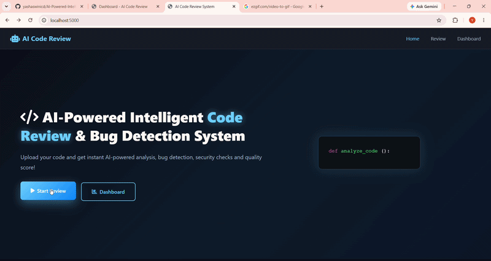

# AI-Powered Intelligent Code Review & Bug Detection System

**Detect · Locate · Fix · Verify** — for 12 programming languages.




Paste or upload code in any supported language and any length (up to 50,000
lines). The system reports **every problem with its line number**, repairs
what can be repaired safely, **verifies the corrected code**, and returns it
together with a diff and a downloadable report.

---

## What it does

| Step | What happens |
|------|--------------|
| 1. Detect language | From the file extension, the language you pick, or the code itself |
| 2. Find problems | Syntax errors, bugs, security risks and style issues, each with line and column |
| 3. Fix | Mechanical repairs are applied one at a time |
| 4. Verify | After every repair the code is analysed again; a repair that does not help or breaks something else is discarded |
| 5. Report | Corrected code, diff, quality score before/after, TXT / JSON / PDF report |

### Supported languages

Python, Java, C, C++, C#, JavaScript, TypeScript, Go, PHP, Rust, Kotlin, Swift.

| Check | Python | Other languages |
|-------|:-----:|:---------------:|
| Missing colon / semicolon, unclosed or extra brackets, unterminated strings and comments | yes | yes |
| Undefined variables (scope aware), typo correction, missing standard imports | yes | – |
| Division by zero (literal, or a variable that is only ever zero) | yes | yes |
| Hard-coded passwords / API keys → moved to environment variables | yes | most |
| Empty `except` / `catch`, bare `except`, mutable default arguments | yes | catch blocks |
| `if (x = 5)` assignment in a condition, Java `==` on strings, JS `==` | – | yes |
| Unreachable code, unsafe C functions (`gets`, `strcpy` ...) | yes | yes |
| SQL injection, XSS, weak hashes (MD5/SHA-1), `eval`, `pickle`, `os.system` | yes | yes |
| Run the corrected program | sandboxed | compile-check if a compiler is installed |

If **gcc / g++ / node / javac** are installed they are used as the final
judge of syntax. If not, the built-in rule engine is used, so nothing extra
has to be installed.

---

## Quick start (Windows)

```bat
python -m venv venv
venv\Scripts\activate
pip install -r requirements.txt
python app.py
```

Open http://127.0.0.1:5000 and go to **Review**.
(`run.bat` does the last two steps for you.)

## Using it

1. Open **Review**, choose a language (or leave *Auto-detect*).
2. Paste code or upload a file.
3. Press **Analyze & Auto-Fix**.
4. Read the issues, the highlighted problem lines, the changes, then copy or
   download the corrected code and the report.

**Analyze only** lists the problems without changing anything.

---

## How the repair is kept safe

* Every repair is a small text edit with exact positions.
* After applying it the whole file is analysed again. The repair is accepted
  only if the targeted problem is gone **and** no new syntax error appeared.
* Fixes that change behaviour are described honestly. Example: a division by
  a variable that is always zero is turned into a guarded expression that
  returns `0`; the report says so, and you can change the value.
* Problems that need a human decision (for example `x / 0` with a literal
  zero, SQL built by string concatenation) are **listed but not changed**.

## Project structure

```
app.py                  Flask routes
config/settings.py      Limits and paths
src/
  language_support.py   Language table + auto-detection
  lexer.py              String/comment aware scanner (all languages)
  universal_analyzer.py Brackets, semicolons, secrets, catch blocks ...
  python_analyzer.py    Python AST analysis, scope resolver, syntax repair
  security_checker.py   SQL injection, XSS, weak crypto, dangerous calls
  compiler_check.py     Optional gcc / g++ / node / javac verification
  universal_fixer.py    Analyse → fix → verify loop
  execution_engine.py   Restricted Python runner
  pipeline.py           End-to-end processing, scoring, verification
  report_generator.py   TXT / JSON / PDF reports
  ml_model.py           Secondary ML risk classifier
templates/ static/      Web interface
tests/                  Unit tests, labelled benchmark programs
utils/stats_store.py    Dashboard statistics
```

## Tests and measured quality

```bat
python -m unittest discover -s tests -t .
python -m tests.run_benchmark
```

The labelled test suite contains **83 programs in 12 languages**
(29 correct programs that must not be flagged). Rule engine only, no compiler:

| Metric | Result |
|--------|--------|
| Precision | 100.0% |
| Recall | 100.0% |
| Correct programs wrongly flagged | 0 of 29 |
| Syntax errors repaired and verified | 100.0% |

**Please read this honestly:** these programs were written together with the
rules, so the numbers are a *regression suite*, not an independent
evaluation. They show that the engine does what it claims on those
situations; real-world code will contain cases that are not covered.

### Machine-learning component

A small TF-IDF + logistic-regression model gives a secondary "risk
estimate" for Python code. It is trained on template-generated snippets and
validated by holding out whole templates (folds split by template (unseen templates)):
accuracy 64%, precision 69%,
recall 57% on **unseen templates**. That is modest, which
is why the rule engine is the primary detector and the model is only shown
as extra information.

## Limitations

* The analysis is **rule based**. It finds the problems listed above, not
  every possible bug. No tool can promise that.
* Without a compiler, syntax checking for non-Python languages uses
  heuristics (they can miss unusual code or, rarely, flag valid code).
  With gcc/node/javac installed the compiler decides.
* Auto-fix covers mechanical problems. Logic errors are not repaired.
* Only Python is executed. The sandbox (blocked imports and calls, separate
  process, time/memory limits) is a safety net for a study project, **not a
  security boundary**. Run unknown code in a container or VM.
* Type checking, dependency resolution and multi-file projects are out of
  scope: each file is analysed on its own.

## Author

Yashaswini C D — GitHub: [@yashaswinicd](https://github.com/yashaswinicd)

Repository: [AI-Powered-Intelligent-Code-Review-and-Bug-Detection-System](https://github.com/yashaswinicd/AI-Powered-Intelligent-Code-Review-and-Bug-Detection-System)

## License

MIT, see `LICENSE`.
